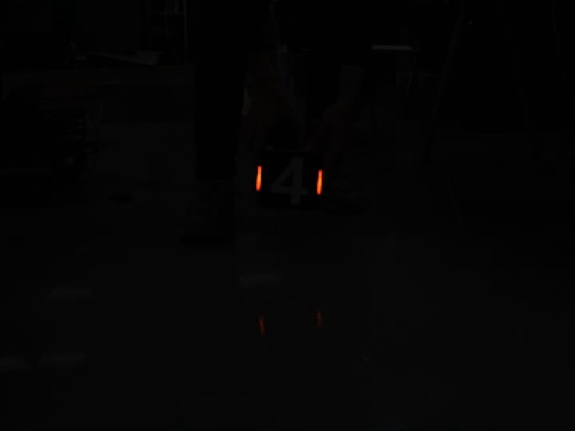
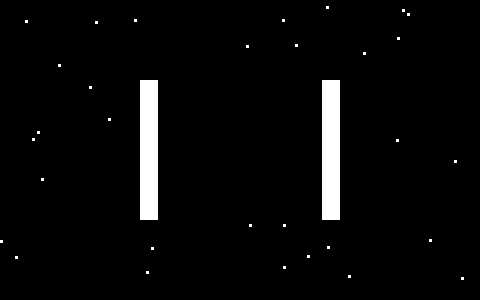
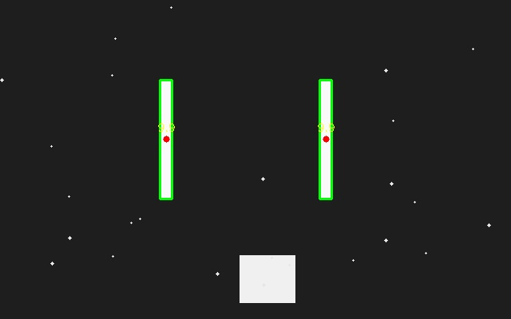

# 装甲板灯条识别 · 阶段 2 任务

> RoboMaster 视觉自瞄 · TJURM 2027 培训阶段 2
> 环境：WSL2 (Ubuntu 22.04) + OpenCV **4.5.4**（源码编译）+ CMake + C++17

---

## 一、我的思路

### 1. 先打通环境，再写业务代码

阶段 2 的第一步是编译 OpenCV，这一步卡了整个项目的前置条件，所以我把"环境可复现"当成第一优先级：按队伍要求把 OpenCV 4.5.4 从源码编译安装到 `/usr/local/opencv4.5.4`（而不是默认的 `/usr/local`），这样和队内其它代码的路径约定一致。

### 2. 参考队内模板组织工程

阶段 2 文档里提到"参照阶段 1 中 test1 的项目架构"，所以我照 `tjurm2027-test1` 的结构来组织：

- `include/` 放头文件、`src/` 放实现、`main.cpp` 作入口
- `CMakeLists.txt` 里显式做 OpenCV 的三步：`find_package` → 指定头文件路径 → 链接库

### 3. 把大任务拆成 4 个递进的小练习

灯条识别的整条链路比较长，直接写容易"一锅粥"，所以我按依赖关系拆成 4 个可独立验证的练习，每个练习都能单独编译运行、单独看结果：

| 练习 | 内容 | 解决的问题 |
|---|---|---|
| `p01_mat` | Mat 构造、属性、像素访问、ROI | 先搞清"图像在内存里是什么" |
| `p02_io_color` | `imread/imwrite`、`cvtColor`、`split/merge`、`inRange` | 学会按颜色提取目标 |
| `p03_threshold` | `threshold`（含 OTSU）、`morphologyEx` | 学会把目标变成干净的黑白图 |
| `p04_contour` | `findContours`、`minAreaRect`、面积/长宽比筛选、画框 | 学会从黑白图里"取出物体" |

**思路是：每一步都先用合成图验证，确认这一环的工作正常，再往上叠。**

### 4. 灯条识别的流程设计

```
读一帧
  ↓
转 HSV（把"颜色"和"亮度"解耦）
  ↓
红色双区间 inRange（红在 H 的两端：≈0~10 和 ≈170~179）
  ↓
合并两段掩码 + 形态学开运算去噪
  ↓
findContours 找轮廓
  ↓
面积 + 长宽比筛选 → 候选灯条
  ↓
两根灯条配对（高度/长度/角度/间距）
  ↓
取 4 个端点 → 排序 → polylines 画四边形
  ↓
输出
```

**几个关键判断**：

- **用 HSV 而不是灰度**：灰度会把红色灯条压得很暗（红色的灰度权重只有 0.299），用 HSV 才能稳定按"颜色 + 亮度"提取。
- **红色必须分两段**：OpenCV 的 H 范围是 0~179，红色同时落在两端，只取一段会漏掉一半像素。
- **筛选靠"长宽比"**：灯条是细长的，实测合成图里灯条的 `minAreaRect` 长宽比约 **9.9**，而方块只有 **1.17**，这个特征区分度极高。

### 5. 输出方案（WSL 环境的限制）

**WSL 里 `cv::imshow` 弹不出窗口**（没有图形显示服务，会报 `Gtk-WARNING: cannot open display`），所以改走两条路：

- `cv::imwrite` 把每帧结果存成图片，输出到 `/mnt/c/Users/lenovo/Desktop/cv_output/`，在 Windows 侧查看
- 或用 `cv::VideoWriter` 把处理结果拼成视频

阶段 2 文档里也允许这两种方式。

---

## 二、目前项目进度

### ✅ 已完成

| 项目 | 状态 |
|---|---|
| OpenCV 4.5.4 源码编译安装（`/usr/local/opencv4.5.4`） | 完成 |
| CMake 工程架构（`find_package` + 头文件路径 + 链接库三步） | 完成 |
| 验证程序可编译、可链接、可输出图片 | 完成 |
| `p01_mat` 练习（Mat 基础） | 完成 |
| `p02_io_color` 练习（图像 IO + 颜色空间） | 完成 |
| `p03_threshold` 练习（二值化 + 形态学） | 完成 |
| `p04_contour` 练习（轮廓 + 筛选 + 画框） | 已跑通，参数含义还在消化 |

### 🚧 进行中

- 消化 `p04_contour` 里的 `findContours` / `minAreaRect`：目前能做到"照着改参数跑通"，但还没到"能独立推导每个参数该怎么设"。

### ⬜ 待完成

| 项目 | 说明 |
|---|---|
| 视频逐帧读写 | `VideoCapture` 循环读帧、`VideoWriter` 输出 |
| 真实视频上的灯条提取 | 红色 HSV 双区间 + 形态学，在真实画面（很暗、有倒影）上调参 |
| 灯条配对 | 把两根灯条判为同一块装甲板 |
| 四点连线绘制 | 取两根灯条的上下端点，按顺序连成四边形 |
| 结果输出 | 图片序列或视频 |
| （选做）PnP 位姿解算 | `solvePnP` + `projectPoints` 画 FLU 坐标轴 |

---

## 三、效果图片

### 1. 测试视频原始帧

实际任务视频（720×540，25fps，101 帧）中的一帧。场景很暗（整帧平均亮度只有约 5/255），灯条是画面里唯一亮的东西，装甲板上有数字标识。



### 2. 形态学去噪效果

左：二值化后（含大量噪点）；右：开运算后（噪点被清除，只剩目标）。



### 3. 轮廓识别 + 筛选 + 画框

在合成测试图上的完整效果：绿框是识别出的灯条，红点是中心，黄字是长宽比。

注意底部的方块（长宽比 1.17）被正确过滤掉了，只有长宽比 9.93 的两根细长灯条被保留。



---

## 四、遇到的问题（及解决过程）

### 1. OpenCV 编译时被系统杀掉（OOM）

**现象**：`make` 跑到一半报 `c++: fatal error: Killed signal terminated program cc1plus`，大量 `.cpp` 编译中断。

**原因**：`make -j` 不加数字等于"无限并行"，本机 24 核会同时开 24 个编译进程，而 WSL 默认只分到 15 GB 内存 → 峰值内存远超上限，被内核 OOM Killer 杀掉。

**解决**：
- 把并发数降到 `-j6`
- 给 WSL 增加内存（`.wslconfig` 里设 `memory=24GB`、`swap=16GB`）

### 2. `cmake` 配置阶段卡死不动

**现象**：`cmake` 运行几分钟没有任何输出，进程 CPU 占用极低。

**原因**：配置阶段要下载第三方依赖 `ippicv`（约 31 MB），从 `raw.githubusercontent.com` 下载速度极慢甚至断开。

**解决**：加 `-DWITH_IPP=OFF` 跳过这个依赖。IPP 只是 Intel 的图像加速库，对灯条识别没有影响。

### 3. 编译报 `undefined reference to 'main'`

**现象**：链接阶段失败，说找不到 `main`。

**原因**：**文件没保存**。VS Code 编辑器里有代码，但磁盘上的 `.cpp` 还是 0 字节（新建后没按 `Ctrl+S`）。

**解决**：`Ctrl+S` 保存后重新编译。后来打开了 VS Code 的自动保存，避免再犯。

### 4. `CMake Error: does not appear to contain CMakeLists.txt`

**现象**：文件明明在资源管理器里能看到，CMake 却说找不到。

**原因**：**文件名大小写错误** —— 写成了 `CmakeLists.txt`（小写 m），而 CMake 只认 `CMakeLists.txt`。**Linux 文件系统区分大小写**，Windows 不区分，所以这个错在 Windows 上不会暴露。

**解决**：删除错误文件，用正确大小写重建。

### 5. 坐标系顺序反复搞混

**现象**：画出来的框位置不对、或者程序断言崩溃 `0 <= roi.x && roi.x + roi.width <= m.cols`。

**原因**：OpenCV 里三套坐标顺序不一致：

| 场景 | 顺序 |
|---|---|
| `Mat(rows, cols, ...)` | **(高, 宽)** |
| `img.at<T>(y, x)` | **(行, 列)** |
| `Rect(x, y, w, h)` / `Point(x, y)` | **(横, 纵)** |

**解决**：写代码时强制自己标注注释，比如 `// (y=50, x=80) ← 第 50 行、第 80 列`。

### 6. `img.channels` 编译报错

**现象**：`error: cannot bind 'std::ostream' lvalue ...`

**原因**：`channels()` 是**成员函数**，必须带括号；而 `rows` / `cols` 是**成员变量**，不能带括号。两者混了。

### 7. `imwrite` 报 `could not find a writer for the specified extension`

**现象**：保存图片时抛异常。

**原因**：文件名写成了 `ex5_grey,jpg` —— **点号打成了逗号**，OpenCV 看到的后缀是 `,jpg`，不认识。

### 8. `at<uchar>` 打印出来是空白

**现象**：`std::cout << gray.at<uchar>(y,x)` 什么都不显示。

**原因**：`uchar` 本质是 `unsigned char`，`cout` 会按**字符**输出而不是数字。像素值 0 和 1 对应 ASCII 控制字符，看不见。

**解决**：加 `(int)` 强制转换。

### 9. WSL 里 `imshow` 无法显示

**现象**：`Gtk-WARNING: cannot open display:`

**原因**：WSL 默认没有图形显示服务。

**解决**：改用 `imwrite` 输出到 `/mnt/c/...`（Windows 桌面），在 Windows 侧查看。

### 10. `RNG` 随机数结果不可复现

**现象**：同样的种子 `12345`，两种写法撒出来的噪点位置不同，像素统计结果差 9 个。

**原因**：**C++ 函数参数的求值顺序是未定义的**。把多个 `rng.uniform(...)` 写在同一个函数调用的参数列表里（比如 `circle(img, Point(rng.uniform(...), rng.uniform(...)), rng.uniform(...), ...)`），编译器可以按任意顺序求值，导致随机数消耗顺序不同。

**解决**：改成先单独取出变量，再调用函数 —— 顺序确定，跨编译器结果一致。

### 11. `THRESH_OTSU` 的阈值反直觉

**现象**：黑白各半的图，以为 OTSU 会给出 128，实际给出 0。

**原因**：对完美的双峰图，任何能分开两类的阈值都是等优解，OTSU 取了较低的那个。**关键看"分出来的像素数对不对"，而不是阈值数字好不好看。**

### 12. 形态学核太大把目标削没了

**现象**：用 19×19 的核做开运算，灯条完全消失（白像素从 2520 变成 0）。

**原因**：灯的宽度只有 18 像素，核比目标还宽，腐蚀一遍就把目标吃掉了。

**结论**：核尺寸要满足 **噪点尺寸 < 核 < 目标最窄宽度**。

---

## 五、下一步计划

1. 用 `VideoCapture` 读完整视频（101 帧），确认读帧正常
2. 挑单帧（第 50 帧）调通红色 HSV 双区间 + 形态学，输出干净的掩码
3. 接 `findContours` + 筛选，每帧稳定找出两根灯条
4. 实现配对逻辑，画出装甲板四边形
5. 跑完整视频，输出结果图序列 / 视频
6. （有时间）尝试 `solvePnP` 位姿解算

---

## 六、参考

- [OpenCV 4.5.4 官方文档](https://docs.opencv.org/4.5.4/)
- [OpenCV 官方教程](https://docs.opencv.org/4.5.4/d9/df8/tutorial_root.html)
- 队内开源参考：`HHgzs/TJURM-2024`、`HHgzs/OpenRM-2024`
